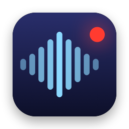

<p align="center"></p>

# Wiretapper

Wiretapper is a small, open-source macOS menu bar app that records your Mac's internal audio to a file. It records what your Mac is playing and never records a microphone.

> ## ⚠️ Disclaimer
>
> This app is:
> - **Vibecoded**: written with AI assistance. I can't read or write code and don't know exactly what the AI wrote.
> - **Open source**: free to read, use, and modify
> - **Collecting no data**: my apps are not meant to collect any data, and I never will intentionally collect any
> - **Experimental**: they may be buggy, incomplete, or break without notice
>
> **Use at your own risk.** There is no warranty of any kind.
> When in doubt, have your own AI or yourself review the code before you run anything.
>
> **Found a problem?** If you can show that one of my apps collects data or has bugs, open an issue or send a commit. I will fix it right away.

## Features

- Left-click the menu bar icon to start or stop recording.
- Right-click or Control-click the icon to open the menu.
- See the elapsed time next to the icon while recording.
- Save recordings as:
  - M4A (AAC 320 kbps)
  - FLAC
  - WAV (24-bit)
  - AIFF (24-bit)
- Choose your output folder. The default is `~/Music/Wiretapper`.
- Get a notification when a recording is saved. Click it to show the file in Finder.
- Optionally start Wiretapper when you log in.

## Install

### With Homebrew

```bash
brew tap printmoney/tap
```

```bash
brew trust printmoney/tap
```

```bash
brew install --cask wiretapper
```

Homebrew asks you to trust third-party taps once before installing from them.

Update with `brew upgrade --cask wiretapper`. Uninstall with `brew uninstall --cask wiretapper`, and add `--zap` to also remove its settings. Your recordings are never deleted.

### Manual download

1. Download `Wiretapper.zip` from the [releases page](https://github.com/printMoney/wiretapper/releases).
2. Open the zip file and drag **Wiretapper** into your **Applications** folder.

### First launch

macOS may block Wiretapper the first time because this beta is not notarized by Apple. If it does, go to **System Settings > Privacy & Security**, scroll down, and click **Open Anyway** next to Wiretapper.

## Requirements

- macOS 14.4 or later
- Xcode 16 or later if you want to build the app yourself

## Build and run in Xcode

1. Download or clone this repository.
2. Double-click `Wiretapper.xcodeproj` to open it in Xcode.
3. At the top of the Xcode window, check that the scheme says **Wiretapper** and the destination says **My Mac**.
4. Click the **Play** button, or press **Command-R**.
5. Look for the small circle icon near the right side of your menu bar. Wiretapper has no Dock icon or main window.

## How permissions work

**System audio recording:** macOS asks for permission the first time you record. If you deny it, Wiretapper shows a button that opens System Settings. You can change it later in **System Settings > Privacy & Security > Screen & System Audio Recording**, under **System Audio Recording Only**.

**Notifications:** macOS asks whether Wiretapper can show notifications. If you turn them off, recording still works, and problems appear in an alert window instead.

**Microphone:** Wiretapper does not request microphone access and does not open any microphone.

Development builds are signed locally, so macOS may ask for system audio permission again after the code changes.

## Good to know

- WAV and AIFF files can't be larger than 4 GB, which is about 4 hours at 48 kHz. Wiretapper saves the recording and tells you if it reaches that limit.
- Recording stops and saves if your sound output device changes.
- Recording stops and saves when less than about 200 MB of disk space is left, so the file stays playable.
- If Wiretapper crashes or is force quit while recording, it tells you the next time it opens, because that file may not play.
- M4A recordings above 48 kHz are converted to 48 kHz.
- Apps that replay another app's sound can make recordings echo. Wiretapper leaves out Volume Rocker for this reason. Other apps that work this way may need to be closed while recording.

## Roadmap

- Record microphone

## License

Wiretapper is released under the [MIT License](LICENSE). It uses only Apple's built-in frameworks and bundles no third-party code.
